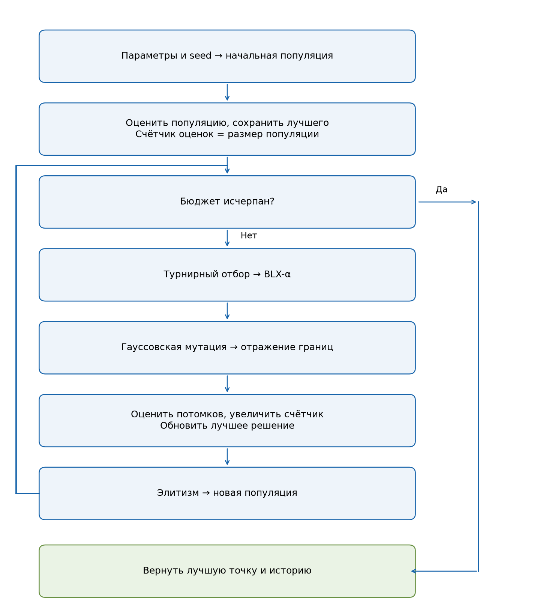
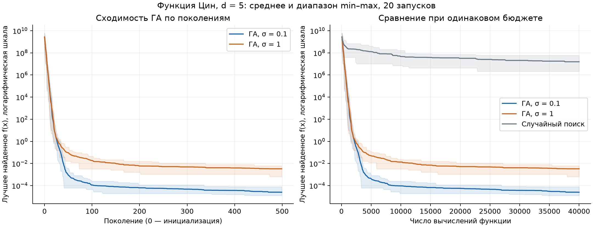
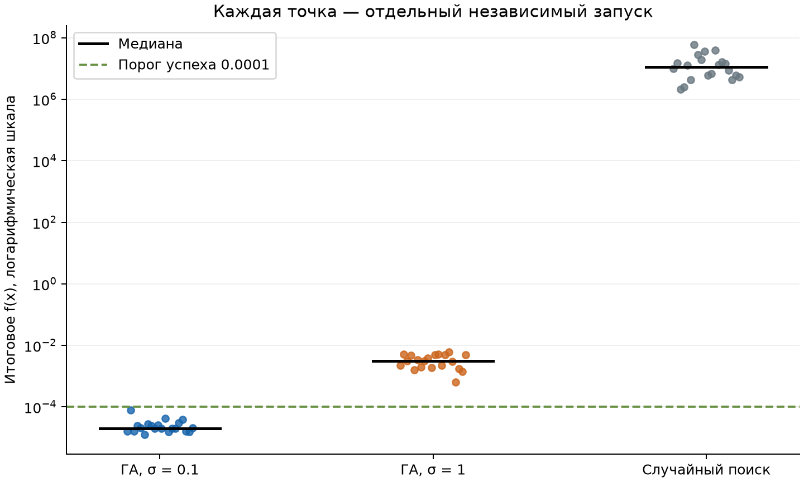

# Лабораторная работа № 1

## Многомерная оптимизация функции Цин генетическим алгоритмом

Группа: **527**. Номер в списке: **3**. Год: **2026**. Вариант: **12**.

Работа исследует вещественный генетический алгоритм для минимизации функции Цин.
Выполнено сравнение двух масштабов гауссовской мутации и равномерного случайного поиска.
По медиане итоговой ошибки лучшей из двух конфигураций стала **ГА, σ=0.1**.
Ниже приведены постановка, собственная реализация операторов и результаты всех запусков.

## 1 Постановка и индивидуальный вариант

По методическим указаниям $N=3$, $Q=2$, $Y=26$:

$$V=1+((17N+7Q+Y)\bmod20)=1+(91\bmod20)=12.$$

$$d=5+(V\bmod6)=5.$$

Требуется найти приближённое глобальное решение:

$$\min_{x\in[-500,500]^5} f(x),\qquad f(x)=\sum_{i=1}^5(x_i^2-i)^2.$$

Каждое слагаемое неотрицательно. Все они одновременно равны нулю при
$x_i=\pm\sqrt{i}$. Поэтому точный глобальный минимум равен $f^*=0$,
а множество глобальных минимумов содержит $2^5=32$ точки.

Ошибка по значению функции равна $f(x)-f^*=f(x)$. Дополнительно фиксируем практический
критерий успеха: $f(x)\le 0.0001$; он служит для подсчёта доли успешных запусков,
но не останавливает алгоритм раньше общего бюджета. Это выбранный критерий эксперимента,
а не заданная преподавателем точность. Из суммы квадратов следует, что при таком успехе
каждое $|x_i^2-i|\le\sqrt{0.0001}$.

Известные корни используются только для проверки результата и тестирования функции.
При инициализации, селекции, кроссовере и мутации аналитическое решение не используется.

## 2 Представление и фитнес

Особь — массив из пяти вещественных координат. Генотип и фенотип совпадают,
декодирование тождественно. Допустимость означает принадлежность каждой координаты
отрезку $[-500,500]$; дополнительных ограничений нет.

Для сравнения особей используется непосредственно $f(x)$: меньшее значение лучше.
Турнирная селекция не требует преобразования к положительной величине пригодности
или инвертирования целевой функции.

## 3 Генетический алгоритм

1. Инициализировать 80 особей независимо и равномерно на всей допустимой области.
2. Вычислить функцию каждой особи и сохранить лучшую точку и её значение.
3. Для каждого потомка выбрать двух родителей независимыми турнирами размера 3.
   Участники выбираются с возвращением; побеждает участник с минимальным значением функции.
4. С вероятностью 0.9 применить BLX-α, иначе скопировать первого родителя.
5. Независимо мутировать каждую координату с вероятностью 0.2.
6. Отразить вышедшие за границы координаты обратно в допустимую область.
7. Вычислить функцию потомков, обновить лучшее найденное решение.
8. Заменить худшего потомка лучшей известной особью — элитизм с одной сохраняемой особью.
9. Повторять, пока не израсходован бюджет 40000 оценок функции.

### Кроссовер BLX-α

Для родительских координат $a_i,b_i$ положим $r_i=|a_i-b_i|$.
Координата потомка независимо выбирается из равномерного распределения:

$$c_i\sim U\left(\min(a_i,b_i)-\alpha r_i,\ \max(a_i,b_i)+\alpha r_i\right),\quad \alpha=0.5.$$

Оператор работает с вещественным представлением, смешивает координаты родителей
и позволяет выходить за их текущий интервал. Покомпонентное смешивание согласуется
с разделимостью функции Цин: каждое слагаемое зависит от одной координаты.
BLX-α реализован самостоятельно и выполняет дополнительное задание лабораторной.

### Мутация и ограничения

Для выбранных координат $c_i\leftarrow c_i+\varepsilon_i$, где
$\varepsilon_i\sim\mathcal{N}(0,\sigma^2)$. Масштаб σ задан в единицах координат,
одинаков для всех пяти координат и не меняется по поколениям.
Он сравнивается в двух конфигурациях: 0.1 и 1.0.

Границы обрабатываются отражением. Для $l=-500$, $u=500$, $w=u-l$:

$$t=(x-l)\bmod(2w),\qquad x'=l+\min(t,2w-t).$$

Формула корректна и при многократном выходе за границы. Она не приклеивает
все вышедшие значения к граничной точке, как простое усечение.

### Элитизм и вычислительный бюджет

Оценки сохраняемых элитных особей берутся из кеша. Каждая новая особь оценивается один раз,
включая потомка, которого затем может вытеснить элита. Инициализация входит в бюджет.
При текущих параметрах: 80 начальных оценок и 499 полных поколений по 80 оценок;
итого ровно 40000. Поколение 0 — начальная популяция.
Для произвольного бюджета код также поддерживает неполное последнее поколение.

Сохранение элиты обеспечивает невозрастание лучшего найденного значения,
но не даёт математической гарантии достижения глобального минимума за конечный бюджет.

## 4 План эксперимента

| Параметр | Значение |
|---|---|
| Функция и размерность | Цин, d=5 |
| Область | [-500, 500] для каждой координаты |
| Размер популяции | 80 |
| Турнир | 3 участника с возвращением |
| Вероятность кроссовера | 0.9 на пару |
| BLX-α | α=0.5 |
| Вероятность мутации | 0.2 на координату |
| Масштабы мутации | σ=0.1 и σ=1.0 |
| Элитизм | Одна лучшая особь |
| Остановка | 40000 вычислений функции, включая инициализацию |
| Независимые запуски | 20 для каждого метода |
| Seed | 0, 1, 2, 3, 4, 5, 6, 7, 8, 9, 10, 11, 12, 13, 14, 15, 16, 17, 18, 19 |

Между конфигурациями ГА меняется только масштаб мутации. Случайный поиск независимо
выбирает 40000 точек равномерно на всей области и сохраняет лучшую.
Всего выполнено 60 запусков и 2,400,000 вычислений функции.
Для всех методов используются одни и те же номера seed. Запуски разных seed независимы;
сравнения методов при одинаковом seed являются парными. Начальная выборка ГА и первые
80 точек случайного поиска при одинаковом seed совпадают.

Времена измерены через perf_counter вокруг оптимизатора; построение графиков, запись файлов
и подготовка отчёта в них не входят. Порядок методов фиксирован, аппаратная нагрузка не контролируется,
поэтому время носит справочный характер. Основной ресурс сравнения — число оценок функции.

## 5 Результаты серии запусков

Все значения ниже относятся к лучшей точке, найденной к концу каждого запуска.
Стандартное отклонение выборочное, с делителем n−1.

| Метод | Лучшее | Среднее | Медиана | Станд. откл. | Худшее | Доля успехов |
|---|---:|---:|---:|---:|---:|---:|
| ГА, σ=0.1 | 1.260085e-05 | 2.534607e-05 | 2.026788e-05 | 1.494273e-05 | 7.991637e-05 | 100% |
| ГА, σ=1 | 6.313892e-04 | 3.303846e-03 | 3.149645e-03 | 1.577859e-03 | 6.128929e-03 | 0% |
| Случайный поиск | 2.097682e+06 | 1.541302e+07 | 1.144543e+07 | 1.456442e+07 | 5.869948e+07 | 0% |

| Метод | Оценок за запуск | Среднее время, с |
|---|---:|---:|
| ГА, σ=0.1 | 40000 | 0.0219 |
| ГА, σ=1 | 40000 | 0.0212 |
| Случайный поиск | 40000 | 0.0036 |

Линии показывают арифметическое среднее лучшего найденного значения по серии,
полупрозрачная область — минимум и максимум по запускам. Это диапазон наблюдений,
а не доверительный интервал. Вертикальная шкала логарифмическая.
Слева приведена требуемая динамика ГА по поколениям; справа все методы сопоставлены
по числу оценок функции. Для случайного поиска поколений нет: он проверяется пакетами
по 80 точек только для согласованного сохранения истории.

Каждая точка — один запуск; чёрные отрезки обозначают медианы.
Пунктир соответствует принятому порогу успеха.

### Лучшее найденное решение

Метод: **ГА, σ=0.1**, seed **5**.

$$f(x)=1.260085133867e-05.$$

В таблице проверяется расстояние модуля координаты до соответствующего корня,
поскольку оба знака являются допустимыми глобальными минимумами.

| i | Найденное xᵢ | √i | Ошибка модуля координаты |
|---|---:|---:|---:|
| 1 | -0.999422316631 | 1.000000000000 | 5.776834e-04 |
| 2 | 1.414666148596 | 1.414213562373 | 4.525862e-04 |
| 3 | 1.732310440450 | 1.732050807569 | 2.596329e-04 |
| 4 | -1.999264763700 | 2.000000000000 | 7.352363e-04 |
| 5 | 2.235975093965 | 2.236067977500 | 9.288353e-05 |

### Анализ

По медиане ГА, σ=0.1 превосходит ГА, σ=1:
2.026788e-05 против 3.149645e-03, отношение
155.40.
При парном сравнении номеров seed эта конфигурация получила меньшее итоговое значение
в 20 из 20 случаев. Это описательная характеристика,
а не результат отдельного теста статистической значимости.

Масштаб мутации влияет на компромисс между исследованием области и точной донастройкой.
Более крупные возмущения чаще выводят потомков из узкой окрестности корня,
тогда как меньшие позволяют точнее уточнять координаты после сжатия популяции.
Вывод о лучшей конфигурации относится к данной функции, бюджету и двум проверенным масштабам;
глобально оптимальный масштаб мутации в этой работе не найден.

Медиана лучшего ГА меньше значения случайного поиска.
Медиана случайного поиска равна 1.144543e+07; отношение к медиане лучшего ГА
составляет 5.647e+11.
Большая область поиска делает равномерную выборку неэффективной: хорошие значения требуют
одновременного попадания всех пяти координат в небольшие окрестности ±√i.
ГА использует найденные удачные координаты и уточняет распределение потомков.

Функция имеет несколько минимумов, однако все её локальные минимумы глобальные.
Действительно, производная слагаемого равна $4x_i(x_i^2-i)$: стационарные точки
лежат при 0 и ±√i; ноль является максимумом соответствующего одномерного слагаемого,
а ±√i — минимумами. Поэтому нельзя утверждать, что Цин содержит плохие локальные минимумы
и обязательно трудна для локального метода. Она гладкая и разделимая; подходящий локальный
метод может быть эффективнее ГА. Локальный метод в обязательном сравнении не исследовался.

Доля успешных запусков лучшей конфигурации составила 100%.
Все запуски лучшей конфигурации достигли выбранного порога. Отчёт показывает также худший результат
(7.991637e-05), чтобы оценка не опиралась только на один удачный запуск.
Точное аналитическое значение 0 используется как ориентир, а полученная точка остаётся
приближённым численным решением.

## 6 Проверка корректности и ограничения

Автоматические тесты проверяют значения функции в простых точках и во всех 32 минимумах,
отражение с многократным выходом за границы, интервал BLX-α, воспроизводимость seed,
независимое получение разных траекторий, допустимость результатов и невозрастание лучшего значения.
Фактическое число оценённых особей подсчитывается обёрткой функции и сравнивается
с заявленным бюджетом, в том числе для неполного последнего поколения.

Ограничения исследования: одна функция, одна размерность, один бюджет, два масштаба мутации,
фиксированные турнир и кроссовер; проверена серия из 20 seed.
Нет доказательства эффективности для других задач или гарантий нахождения точного минимума.
Следующие исследования могут включать адаптивную мутацию, другие размеры популяции,
локальный поиск и отдельный анализ разнообразия популяции.

## 7 Воспроизведение и материалы

Инструкция запуска — в [README](../README.md). Исходные параметры — [config.json](config.json).
Параметры и номера seed задаются конфигурацией; альтернативный путь передаётся через --config.

- [runs.csv](runs.csv) — все итоговые значения, координаты, время и число оценок.
- [history.csv](history.csv) — история каждого запуска.
- [summary.csv](summary.csv) — агрегированные статистики.
- [manifest.json](manifest.json) — версии среды, хеш конфигурации и исходного кода.
- [convergence.svg](convergence.svg) и [final_values.svg](final_values.svg) — векторные графики.

Время и дата запуска при повторении изменятся. Для точного воспроизведения численных
результатов следует использовать версии библиотек из manifest.json и requirements-lock.txt.
Исходные задания: Р. В. Душкин, «Эволюционное программирование и генетические алгоритмы»,
комплекс лабораторных работ, разделы 1 и «Лабораторная работа № 1»;
сопутствующий файл «(1)» содержит формулу и границы функции Цин, пункт 12.

## 8 Краткие ответы для защиты

- **Генотип и фенотип:** совпадающие вещественные векторы из пяти координат.
- **Почему турнир:** напрямую сравнивает значения задачи минимизации, без масштабирования фитнеса.
- **Селективное давление:** размер турнира 3; его увеличение обычно усиливает предпочтение лучших особей.
- **Может ли кроссовер нарушить границы:** да, BLX расширяет родительский интервал; применяется отражение.
- **Зачем мутация:** создаёт новые значения и поддерживает поиск после сближения родителей.
- **Зачем элитизм:** сохраняет лучшее найденное решение при случайном ухудшении потомков.
- **Почему 20 запусков:** один seed не показывает разброс качества и устойчивость метода.
- **Почему сравнение честное:** каждый метод использует ровно 40000 оценок одной и той же функции.
- **Что гарантировано математически:** f≥0 и f=0 при xᵢ=±√i. Качество ГА подтверждено экспериментом.
