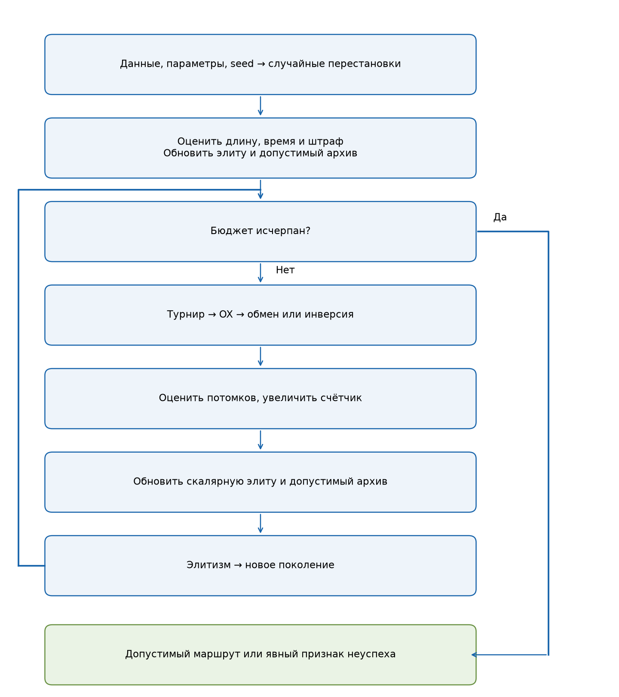
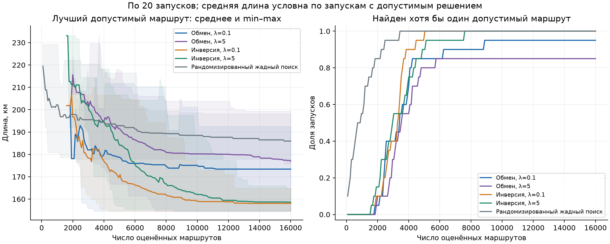
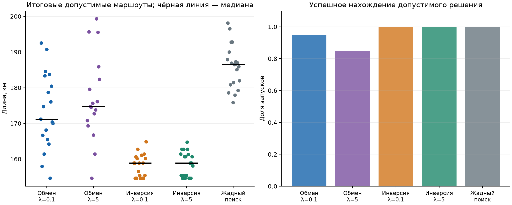
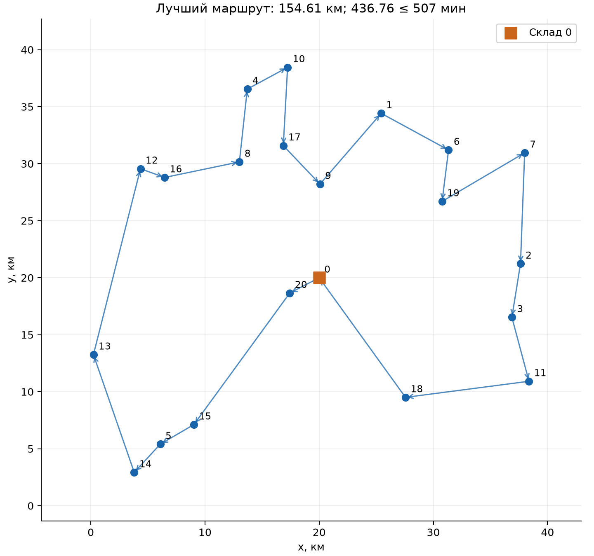

# Лабораторная № 2 — маршрут доставки

Белов Фёдор, группа Б24-527, номер 3, вариант 12, 2026 год.
V=1+((17·3+7·2+26) mod 20)=12.

## Задача

Один автомобиль выезжает со склада 0, посещает 20 адресов по одному разу
и возвращается на склад. Нужно минимизировать расстояние при ограничении
полной продолжительности рейса.

Генотип — перестановка клиентов $\pi=(\pi_1,\ldots,\pi_n)$.
Фенотип — маршрут со складом в начале и конце: $\pi_0=\pi_{n+1}=0$.

$$L(\pi)=\sum_{k=0}^n d_{\pi_k,\pi_{k+1}}\to\min,$$

$$T(\pi)=\sum_{k=0}^n \tau_{\pi_k,\pi_{k+1}}+\sum_{i=1}^n s_i
\le 507\ \text{мин}.$$

Здесь dᵢⱼ — евклидово расстояние, τᵢⱼ — направленное время проезда,
sᵢ — обслуживание. Вместимость автомобиля и временные окна не рассматриваются.

## Данные

Набор сгенерирован с seed 5270312 и сохранён в
[instance.json](instance.json).

- Склад — (20,20) км, клиенты равномерно распределены на [0,40]² км.
- Номинальная скорость — 0,6 км/мин.
- Время дуги: $\tau_{ij}=d_{ij}c_{ij}/0.6$, где cᵢⱼ независимо выбирается
  из U(0,8;1,8). Матрица несимметрична, её диагональ нулевая.
- Обслуживание — целое число от 3 до 8 минут, на складе — 0.

Для выбора лимита построен маршрут ближайшего соседа по времени и улучшен
инверсиями сегментов. Его время умножено на 1,10 и округлено вверх.
Так получен хотя бы один допустимый маршрут. В стартовую популяцию и результаты
алгоритмов этот маршрут не добавляется.

Коэффициенты нагрузки фиксированы на весь рейс.
Время проезда не является постоянным множителем длины.

## Алгоритм и ограничения

Структурную допустимость обеспечивает перестановка клиентов.
Временное ограничение учитывается штрафом:

$$F_\lambda(\pi)=L(\pi)+\lambda\max(0,T(\pi)-T_{\max}).$$

Сравниваются λ=0.1 и λ=5 км/мин.
Конечный штраф может оставлять недопустимую особь лучшей по F.
Поэтому отдельно сохраняются штрафная элита и лучший допустимый маршрут по L.
Если допустимый маршрут не найден, запуск помечается неуспешным.

1. Создать случайные перестановки и оценить L, T и F.
2. Турнирами выбрать родителей.
3. Применить OX и выбранную мутацию.
4. Оценить потомков, обновить элиту и допустимый архив.
5. Заменить худшего потомка штрафной элитой.
6. Повторять до исчерпания бюджета.

**OX** копирует сегмент первого родителя. Остальные позиции заполняются
в циклическом порядке второго родителя, без уже скопированных клиентов.
Так сохраняются порядок и множество адресов.

**Обмен** меняет местами два клиента. **Инверсия** разворачивает сегмент.
Оба оператора сохраняют перестановку. При направленной матрице инверсия меняет
внутренние дуги, поэтому полное время пересчитывается заново.

Повтор клиента, пропуск адреса, склад внутри хромосомы или неизвестный номер
отклоняются оценщиком. Допуск при проверке времени — 10⁻⁹ минуты.

### Четыре примера маршрутов

Все примеры — корректные перестановки. В последних двух превышен лимит времени.

| Пример | Длина, км | Время, мин | Превышение, мин | Допустим |
|---|---:|---:|---:|---|
| feasible_1 | 196.696 | 460.624 | 0.000 | Да |
| feasible_2 | 210.511 | 497.699 | 0.000 | Да |
| infeasible_1 | 412.511 | 975.460 | 468.460 | Нет |
| infeasible_2 | 488.487 | 1221.655 | 714.655 | Нет |

**feasible_1:** 0 → 20 → 19 → 6 → 7 → 2 → 3 → 11 → 18 → 1 → 4 → 10 → 17 → 9 → 8 → 12 → 16 → 5 → 14 → 15 → 13 → 0.

**feasible_2:** 0 → 9 → 19 → 6 → 7 → 2 → 3 → 11 → 18 → 1 → 4 → 10 → 17 → 20 → 8 → 12 → 16 → 5 → 14 → 15 → 13 → 0.

**infeasible_1:** 0 → 13 → 20 → 2 → 15 → 9 → 16 → 14 → 5 → 12 → 17 → 7 → 3 → 10 → 4 → 18 → 6 → 8 → 19 → 11 → 1 → 0.

**infeasible_2:** 0 → 16 → 13 → 8 → 2 → 7 → 5 → 11 → 12 → 9 → 3 → 15 → 19 → 17 → 4 → 6 → 20 → 14 → 1 → 18 → 10 → 0.

## Эксперимент

| Параметр | Значение |
|---|---|
| Популяция | 80 |
| Размер турнира | 3 |
| Вероятность OX | 0.9 на пару |
| Вероятность мутации | 0.3 на потомка |
| Мутации | Обмен, инверсия |
| Штрафы | 0.1 и 5 км/мин |
| Бюджет | 16000 оценок на запуск |
| Seed | 0, 1, 2, 3, 4, 5, 6, 7, 8, 9, 10, 11, 12, 13, 14, 15, 16, 17, 18, 19 |
| Базовый метод | Рандомизированный ближайший сосед, k=3 |

План 2×2: при сравнении штрафов фиксируется мутация и наоборот.
В каждой конфигурации 20 запусков.
Начальные популяции ГА при одном seed совпадают.

Бюджет ГА: 80 начальных оценок + 199 поколений по 80 оценок. В него входят инициализация и недопустимые потомки.
Сохранённые оценки элиты повторно не вычисляются.

Базовый метод на каждом шаге случайно выбирает одного из k ближайших
по времени непосещённых клиентов. Полный маршрут проверяется на допустимость.
Все 16000 попыток, включая неудачные, входят в бюджет.
Стоимость построения кандидатов различается, поэтому дополнительно измеряется время.

## Результаты

Статистика длины рассчитана только по допустимым итогам.
Число успешных запусков указано отдельно. Стандартное отклонение выборочное.

| Метод | Допустимые запуски | Лучшее, км | Среднее, км | Медиана, км | Станд. откл., км | Худшее, км |
|---|---:|---:|---:|---:|---:|---:|
| Обмен, λ=0.1 | 19/20 | 154.609 | 173.422 | 171.223 | 10.721 | 192.571 |
| Обмен, λ=5 | 17/20 | 154.609 | 176.986 | 174.688 | 11.979 | 199.327 |
| Инверсия, λ=0.1 | 20/20 | 154.609 | 158.087 | 158.912 | 3.201 | 164.876 |
| Инверсия, λ=5 | 20/20 | 154.609 | 158.655 | 158.912 | 3.466 | 164.748 |
| Рандомизированный жадный поиск | 20/20 | 175.840 | 185.967 | 186.590 | 6.114 | 198.130 |

| Метод | Доля допустимых среди оценённых | Среднее время, с |
|---|---:|---:|
| Обмен, λ=0.1 | 35.08% | 0.1369 |
| Обмен, λ=5 | 41.12% | 0.1367 |
| Инверсия, λ=0.1 | 46.92% | 0.1382 |
| Инверсия, λ=5 | 42.49% | 0.1412 |
| Рандомизированный жадный поиск | 0.10% | 0.0830 |

Время включает поиск и работу операторов, без записи файлов и графиков.

Средняя длина слева рассчитана по запускам, уже нашедшим допустимый маршрут;
их состав на ранних шагах меняется. Заливка — min–max.
Справа показана доля таких запусков.

Каждая точка — допустимый итог запуска, чёрный отрезок — медиана.

### Влияние штрафа и мутации

| Изменение | Пар с двумя допустимыми итогами | Средняя разность после − до, км |
|---|---:|---:|
| λ: 0.1 → 5, обмен | 16 | 3.360 |
| λ: 0.1 → 5, инверсия | 20 | 0.568 |
| Обмен → инверсия, λ=0.1 | 19 | -15.378 |
| Обмен → инверсия, λ=5 | 17 | -18.303 |

Отрицательная разность означает сокращение маршрута.
В пары входят только два допустимых результата; доли успеха сравниваются отдельно.

При обмене увеличение λ с 0.1 до 5 снизило число допустимых запусков с 19 до 17. Число запусков с недопустимым лучшим маршрутом по F изменилось с 7 до 3. Медианы длин: 171.223 и 174.688 км.

При инверсии оба штрафа дали 20 допустимых запусков из 20. Медианы длин: 158.912 и 158.912 км.

Число недопустимых штрафных элит и число успешных запусков — разные показатели.

По доле успехов, затем по медиане и среднему выбран вариант
Инверсия, λ=0.1. Медиана выбранной конфигурации ГА — 158.912 км, эвристики — 186.590 км. В этой серии ГА дал меньшую медианную длину.

## Лучший маршрут

Метод: Инверсия, λ=0.1, seed=2.

0 → 20 → 15 → 5 → 14 → 13 → 12 → 16 → 8 → 4 → 10 → 17 → 9 → 1 → 6 → 19 → 7 → 2 → 3 → 11 → 18 → 0

Длина — 154.609202 км.
Время — 436.762804 мин, запас до лимита — 70.237196 мин.

| Порядок | Адрес | Участок, км | Проезд, мин | Прибытие, мин | Обслуживание, мин | Отправление, мин |
|---|---:|---:|---:|---:|---:|---:|
| 0 | 0 | 0.000 | 0.000 | 0.000 | 0 | 0.000 |
| 1 | 20 | 2.907 | 3.970 | 3.970 | 8 | 11.970 |
| 2 | 15 | 14.270 | 41.284 | 53.254 | 6 | 59.254 |
| 3 | 5 | 3.400 | 9.372 | 68.626 | 4 | 72.626 |
| 4 | 14 | 3.372 | 6.785 | 79.412 | 4 | 83.412 |
| 5 | 13 | 10.929 | 27.152 | 110.563 | 7 | 117.563 |
| 6 | 12 | 16.817 | 28.632 | 146.196 | 7 | 153.196 |
| 7 | 16 | 2.249 | 4.996 | 158.192 | 6 | 164.192 |
| 8 | 8 | 6.690 | 14.257 | 178.449 | 3 | 181.449 |
| 9 | 4 | 6.424 | 11.889 | 193.338 | 4 | 197.338 |
| 10 | 10 | 4.012 | 7.646 | 204.984 | 7 | 211.984 |
| 11 | 17 | 6.874 | 9.451 | 221.435 | 5 | 226.435 |
| 12 | 9 | 4.662 | 13.847 | 240.282 | 7 | 247.282 |
| 13 | 1 | 8.204 | 19.571 | 266.854 | 5 | 271.854 |
| 14 | 6 | 6.722 | 17.981 | 289.834 | 4 | 293.834 |
| 15 | 19 | 4.543 | 9.940 | 303.774 | 3 | 306.774 |
| 16 | 7 | 8.394 | 24.697 | 331.472 | 6 | 337.472 |
| 17 | 2 | 9.735 | 13.096 | 350.568 | 5 | 355.568 |
| 18 | 3 | 4.756 | 10.728 | 366.296 | 6 | 372.296 |
| 19 | 11 | 5.810 | 9.360 | 381.656 | 8 | 389.656 |
| 20 | 18 | 10.905 | 18.267 | 407.923 | 5 | 412.923 |
| 21 | 0 | 12.934 | 23.840 | 436.763 | 0 | 436.763 |

Последняя строка — возврат на склад. Полная точность — в [best_route.csv](best_route.csv).

Минимальное остовное дерево имеет длину 125.925220 км и задаёт нижнюю границу:
если удалить ребро тура, останется остовное дерево.
Найденный маршрут длиннее этой границы на 22.78%.
Это не установленное отклонение от неизвестного оптимума.

## Выводы

Конфигурация «Инверсия, λ=0.1»: доля успешных запусков —
100%, медианная длина — 158.912 км.
В 6 запусках ГА лучший по F маршрут нарушал лимит времени, но допустимое решение сохранилось в отдельном архиве.

Сравнение проведено на одном синтетическом наборе, при одном бюджете и двух
штрафах. Статистическая значимость различий не проверялась.
Точный оптимум не вычислялся.

## Материалы

[Запуск](../README.md), [параметры](config.json), [данные](instance.json),
[примеры](examples.json), [запуски](runs.csv), [статистика](summary.csv),
[истории](history.csv), [версии и хеши](manifest.json).

Задание: Р. В. Душкин, «Эволюционное программирование и генетические алгоритмы»,
лабораторная № 2, вариант 12.
