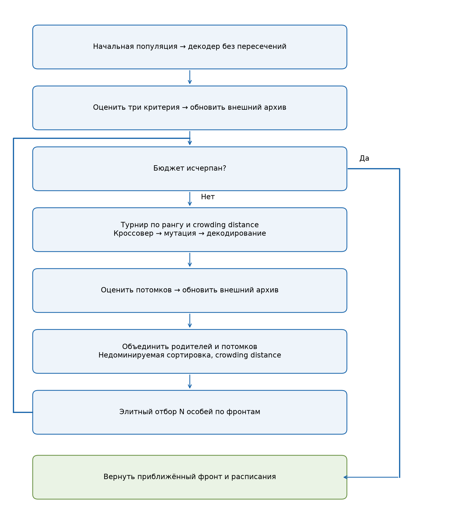
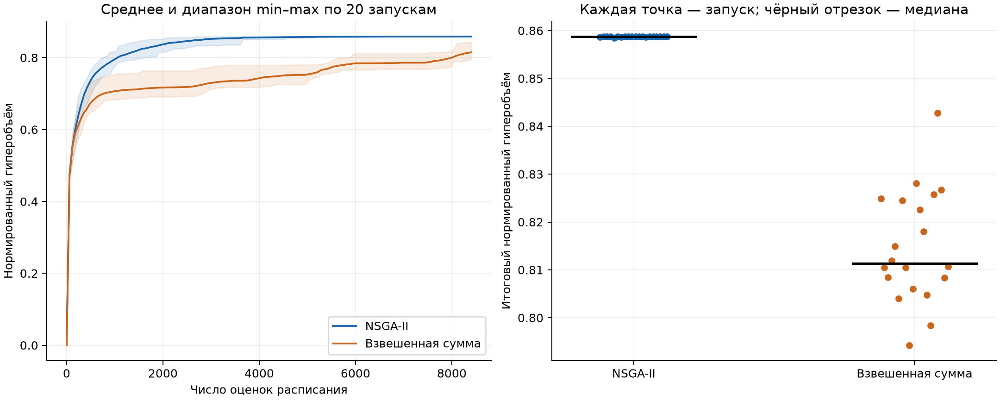
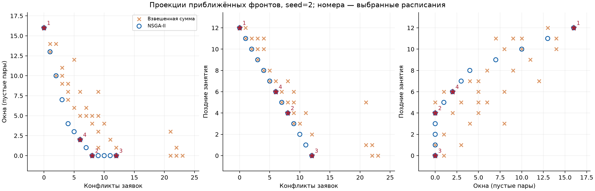
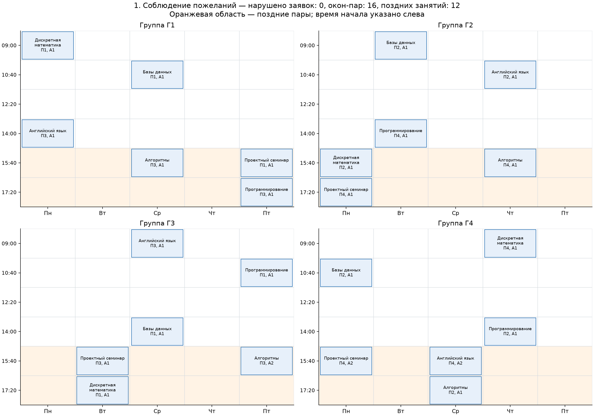
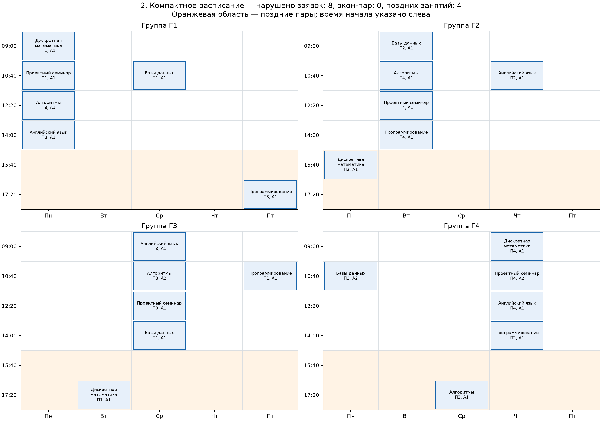
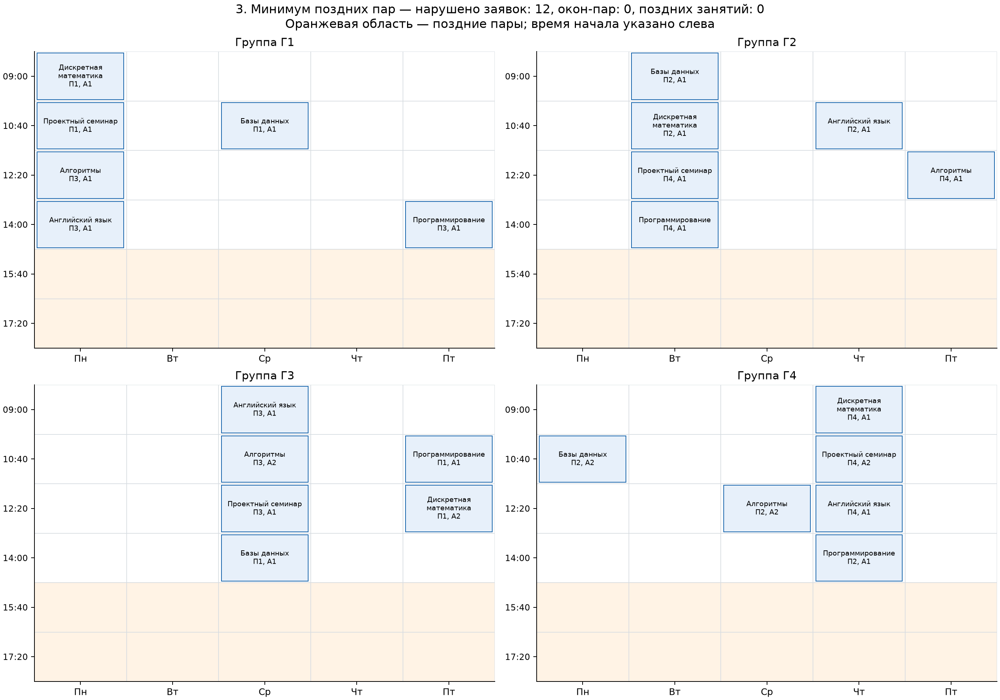
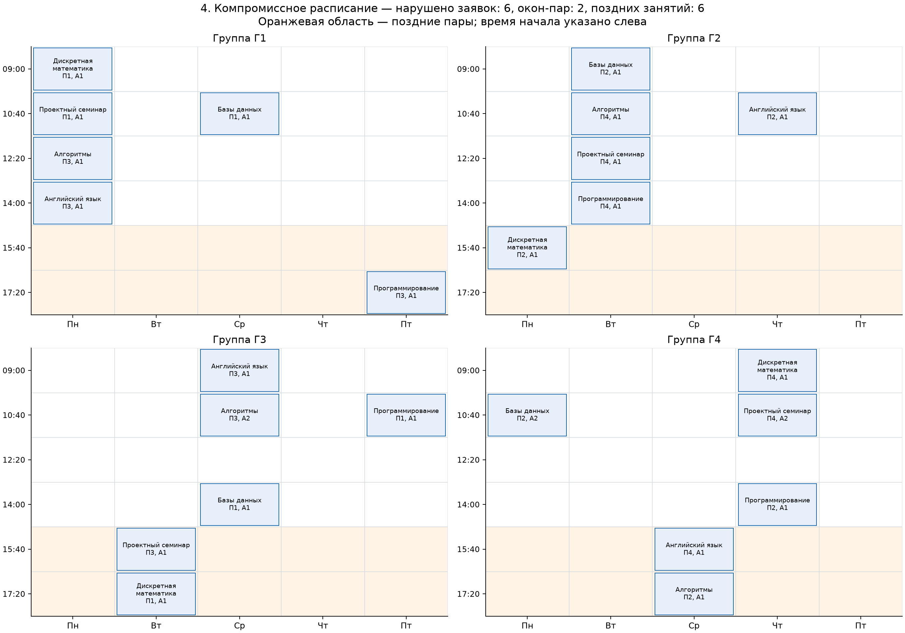

# Лабораторная № 3 — многокритериальное расписание

Белов Фёдор, группа Б24-527, номер 3, вариант 12, трек A, 2026 год.
V=1+((17·3+7·2+26) mod 20)=12.

## Задача и критерии

На пятидневной неделе нужно разместить 24 занятия для четырёх групп
и четырёх преподавателей. В день шесть пар, доступны две одинаковые аудитории.
У каждой группы и преподавателя по шесть занятий.

В один слот у группы и преподавателя может быть только одно занятие,
в аудитории — не более одного. Эти ограничения обеспечивает декодер.

Минимизируются три величины:

1. Нарушенные пожелания по времени — число занятий, перенесённых из заявленного слота.
2. Окна — пустые пары между первым и последним занятием группы за день.
3. Поздние занятия — пятые и шестые пары, начинающиеся в 15:40 и 17:20.

Для занятия e назначаются слот sₑ∈{0,…,29} и аудитория rₑ∈{0,1}.
Желаемый слот обозначен qₑ. Скобки [условие] равны 1, если оно выполнено, иначе 0:

$$f_1=\sum_{e=1}^{24}[s_e\ne q_e].$$

Если Sgd — множество занятых номеров пар группы g за день d, то:

$$W_{gd}=
\begin{cases}
0,&S_{gd}=\varnothing,\\
\max S_{gd}-\min S_{gd}+1-|S_{gd}|,&\text{иначе},
\end{cases}
\qquad f_2=\sum_{g,d}W_{gd}.$$

Свободное время до первой и после последней пары не считается окном.

$$f_3=\sum_{e=1}^{24}[(s_e\bmod6)\ge4].$$

Первый критерий относится к мягким пожеланиям; пересечения занятий запрещены.
Модель не учитывает вместимость аудиторий и внешнюю недоступность преподавателей.

## Данные и представление

Набор находится в [instance.json](instance.json).
Шаблон пожеланий задан конструктивно: у группы g занятия запрашиваются
на дни g, (g+2) mod 5, (g+4) mod 5, на пары 0,3,1,4,4,5.
Seed 5270313 задаёт перестановку названий предметов.

Выполнение всех заявок даёт (f₁,f₂,f₃)=(0,16,12).
Чтобы убрать поздние пары, нужно перенести не менее 12 заявок.
Поэтому одновременно обнулить три критерия нельзя.

Генотип — вектор из 24 целевых слотов, фенотип — назначенное расписание.
Декодер проходит занятия по идентификаторам
и ищет свободное время от указанного слота далее циклически по неделе.
Выбираются первый допустимый слот и первая свободная аудитория.
Критерии считаются по назначенному расписанию.

Место всегда найдётся: группа запрещает не более 5 слотов, преподаватель —
не более 5, полностью занятые аудитории — не более ⌊23/2⌋=11.
Остаётся не менее 9 свободных слотов из 30.

Фиксированный порядок влияет на поиск: перенос одного занятия может
сдвинуть последующие. Одно заявочное расписание включено в начальную популяцию
обоих методов; остальные генотипы случайны. Его оценки входят в бюджет.

## NSGA-II

Решение x доминирует y, если fᵢ(x)≤fᵢ(y) для всех критериев
и хотя бы одно неравенство строгое.

1. Создать и оценить популяцию.
2. Недоминируемой сортировкой назначить ранги фронтов.
3. Внутри фронтов вычислить crowding distance.
4. Турниром выбрать родителей: меньший ранг, затем большее расстояние.
5. Применить кроссовер и мутацию, декодировать и оценить потомков.
6. Объединить родителей с потомками и оставить N особей по фронтам.
   Неполный последний фронт отобрать по crowding distance.
7. Повторять до исчерпания бюджета.

Crowding distance — сумма нормированных разностей соседей по каждому критерию.
У крайних точек непостоянного критерия расстояние бесконечно,
у постоянного критерия вклад нулевой.

Новые механизмы относительно первых двух работ — ранги Парето,
crowding distance и многокритериальный архив. Сортировка и отбор реализованы в scheduling.py.

Внешний архив хранит одно расписание на каждый уникальный недоминируемый
вектор среди всех оценённых кандидатов. В отборе родителей он не участвует.

## Взвешенная сумма и план сравнения

Базовый ГА минимизирует:

$$S_w=w_1f_1/24+w_2f_2/80+w_3f_3/24,\qquad\sum_iw_i=1.$$

Нормировки заданы до поиска. Верхняя граница 80 для окон получена как
4 группы × 5 дней × 4 возможные пустые пары между крайними занятиями.

| Набор | w₁ | w₂ | w₃ |
|---|---:|---:|---:|
| 1 | 1.000 | 0.000 | 0.000 |
| 2 | 0.000 | 1.000 | 0.000 |
| 3 | 0.000 | 0.000 | 1.000 |
| 4 | 0.500 | 0.500 | 0.000 |
| 5 | 0.500 | 0.000 | 0.500 |
| 6 | 0.000 | 0.500 | 0.500 |
| 7 | 0.333 | 0.333 | 0.333 |

Точные веса — в config.json. Бюджет портфеля распределён по весам:
1200, 1200, 1200, 1200, 1200, 1200, 1200 оценок, всего 8400.

Каждый вес использует отдельную популяцию, бинарный турнир по скалярной оценке
и элитизм. Декодер и операторы вариации совпадают с NSGA-II.
Общий архив сохраняет кандидатов от всех весов, не только финальных победителей.

| Параметр | Значение |
|---|---|
| Популяция | 60 |
| Вероятность равномерного кроссовера | 0.9 на пару |
| Вероятность замены гена случайным слотом | 0.04166667 |
| Бюджет на метод и seed | 8400 оценок |
| Seed | 0, 1, 2, 3, 4, 5, 6, 7, 8, 9, 10, 11, 12, 13, 14, 15, 16, 17, 18, 19 |
| Всего оценок | 336000 |

Оценка включает полное декодирование и расчёт трёх критериев.
Начальные популяции и повторные генотипы учитываются.
При равном общем бюджете NSGA-II ведёт один длинный поиск, портфель — несколько
коротких. Разделение бюджета между весами тоже влияет на результат.

## Метрики

Гиперобъём HV — объём объединения прямоугольников от векторов фронта
до точки (25,81,25), делённый на 25·81·25. Эта точка строго хуже всех
достижимых значений. Чем больше HV, тем лучше покрытие пространства критериев.
Объём рассчитан собственным трёхмерным сканированием.

C(A,B) — доля векторов B, слабо доминируемых хотя бы одним вектором A.
Равенство учитывается, поэтому два покрытия не являются дополнениями до единицы.

## Результаты

| Метод | Лучший HV | Средний HV | Медиана HV | Выборочное std | Худший HV |
|---|---:|---:|---:|---:|---:|
| NSGA-II | 0.858765 | 0.858734 | 0.858765 | 0.000066 | 0.858489 |
| Взвешенная сумма | 0.842785 | 0.814800 | 0.811328 | 0.011739 | 0.794252 |

| Метод | Среднее число векторов | Среднее C(метод, другой) | Среднее время, с |
|---|---:|---:|---:|
| NSGA-II | 13.70 | 0.999 | 0.3082 |
| Взвешенная сумма | 39.30 | 0.137 | 0.2161 |

Время включает поиск, архив и HV истории, без файлов и графиков.

Линии — среднее, заливка — min–max по 20 seed.
Между обновлениями используется последнее измеренное значение архива.
Справа каждая точка соответствует запуску, чёрный отрезок — медиане.

Средняя парная разность HV(NSGA-II)−HV(взвешенная сумма) —
0.043934. NSGA-II лучше в 20 парах, хуже в 0,
равен в 0 с допуском 10⁻¹².
Средние покрытия: C(NSGA-II, сумма)=0.999,
C(сумма, NSGA-II)=0.137.

Среднее число векторов: 13.70 у NSGA-II и 39.30 у взвешенной суммы. Количество точек само по себе не показывает качество фронта.

## Расписания с разными приоритетами

Для примеров выбран seed=2: HV NSGA-II ближе всего к медиане серии.
На проекциях показан и парный результат взвешенной суммы.
Недоминируемая в трёх измерениях точка может выглядеть доминируемой
на проекции без третьего критерия.

| № | Расписание | Нарушенные заявки | Окна-пары | Поздние занятия |
|---|---|---:|---:|---:|
| 1 | Соблюдение пожеланий | 0 | 16 | 12 |
| 2 | Компактное расписание | 8 | 0 | 4 |
| 3 | Минимум поздних пар | 12 | 0 | 0 |
| 4 | Компромиссное расписание | 6 | 2 | 6 |

Выбраны разные векторы с приоритетом заявок, окон и раннего завершения.
Совпавшие варианты пропускаются. Четвёртый пример — ближайший к (0,0,0)
нормированный вектор среди оставшихся.

### 1 Соблюдение пожеланий

Приоритет — сохранить заявленное время. Сохранено 24 из 24 заявок; окон-пар — 16, поздних занятий — 12.

### 2 Компактное расписание

Приоритет — убрать пустые пары внутри дня. Сохранено 16 из 24 заявок; окон-пар — 0, поздних занятий — 4.

### 3 Минимум поздних пар

Приоритет — сократить число поздних занятий. Сохранено 12 из 24 заявок; окон-пар — 0, поздних занятий — 0.

### 4 Компромиссное расписание

Выбран компромисс между тремя критериями. Сохранено 18 из 24 заявок; окон-пар — 2, поздних занятий — 6.

На картах указаны предмет, преподаватель и аудитория; поздние пары выделены
оранжевым. Все занятия — в [timetables.csv](timetables.csv),
выбранные генотипы — в [representatives.json](representatives.json).

## Выводы

При этом бюджете NSGA-II дал больший средний HV. Из выбранных расписаний видно,
сколько заявок приходится менять ради сокращения окон и поздних занятий.

Исследован один набор с фиксированным декодером и общим бюджетом.
Глобальный фронт неизвестен; статистическая значимость различий не проверялась.
Взвешенная сумма может пропускать неподдерживаемые точки дискретного фронта,
но именно такие пропуски в этой работе не доказаны.

## Материалы

[Запуск](../README.md), [параметры](config.json), [занятия](instance.json),
[запуски](runs.csv), [статистика](summary.csv), [фронты](fronts.csv),
[истории](history.csv), [версии и хеши](manifest.json).

Задание: Р. В. Душкин, «Эволюционное программирование и генетические алгоритмы»,
лабораторная № 3, трек A, вариант 12.
